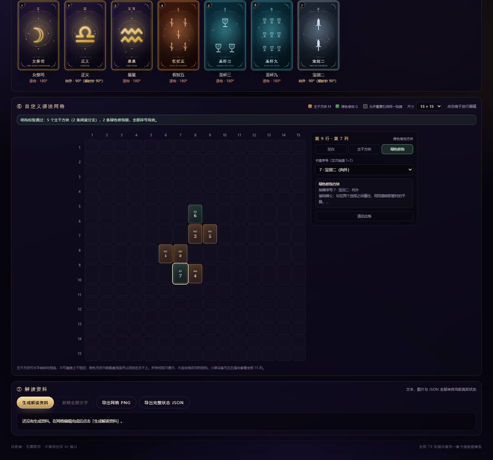
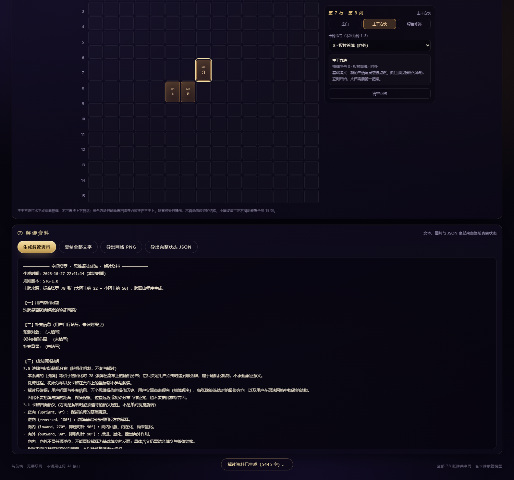

# 塔罗 · 抽牌 ＋ 空间塔罗 · 思维语法系统

两个**纯前端、零依赖**的塔罗程序，共用同一套 78 张卡牌数据与程序化牌面：

| 入口 | 程序 |
| --- | --- |
| **`index.html`** | 传统塔罗抽牌：洗牌 → 结束洗牌 → 指定数量抽牌 → 翻牌 → 牌义 |
| **`spatial.html`** | 空间塔罗 · 思维语法系统：78 张牌空间运动、四向语义、语法网格、解读资料导出 |

不用安装、不用联网、不用构建，**双击 `index.html` 或 `spatial.html` 即可运行**（Chrome / Edge / Firefox / Safari）。两个页面顶部互相有入口链接。

---

## 一、传统抽牌（`index.html`）

| 步骤 | 操作 |
| --- | --- |
| 1 | 点击 **开始洗牌**，牌堆持续洗牌 |
| 2 | 点击 **结束洗牌**，收牌、切牌，牌堆亮起金色光环 |
| 3 | 用 **− / +** 或输入数字指定 **1–10 张** |
| 4 | 点击 **抽牌**，牌飞入扇形牌阵并逐张翻开（正 / 逆位随机） |
| 5 | 点击任意牌查看完整牌义 |

快捷键：`S` 洗牌/停止 · `空格` 结束洗牌 · `D` 抽牌 · `R` 重置 · `Esc` 关闭弹层。


---

## 二、空间塔罗 · 思维语法系统（`spatial.html`）

一个"符号操作台"：用户输入问题，用五个思维按钮让 78 张牌在正方形桌布上运动、改变方向，从中选牌并揭示，然后把牌按自定义语法排列成 15×15 网格，最后导出可直接交给外部 AI 的完整解读资料。

程序**不调用任何 AI、不访问网络、不做预测结论**，只负责符号操作、状态管理与资料输出。


### 2.1 六个阶段

页面顶部有阶段指示条，可随时看到当前进度：

1. **提问**：顶部文本框原样保存问题，不做理解、推断或改写；可选填预测对象 / 时间范围 / 背景。
2. **思维操作**：五个按钮作用于全部 78 张牌，顺序、次数、节奏自由组合。
3. **抽牌**：点击桌布上的牌背，按点击顺序得到抽牌序号 1、2、3……；揭示前只显示牌背与方向，不显示牌名。
4. **揭示**：点击 **预测 / 揭示牌面**，仅已选牌翻开；方向与位置被冻结，进入网格阶段。可用 **返回编辑**（会提示影响）或 **重新开始**（需确认）。
5. **语法网格**：默认 **15×15**（可调 5–15），棕黄色主干方块 + 绿色修饰方块，实时校验。
6. **解读资料**：生成文本、复制、导出网格 PNG、导出完整状态 JSON。

### 2.2 四向语义

| 状态 | 角度 | 语义 |
| --- | --- | --- |
| 正向 upright | 0° | 保留该牌基础寓意 |
| 逆向 reversed | 180° | 基础寓意朝相反方向解释 |
| 向内 inward | 270°（逆时针 90°） | 向内回溯、内在化、尚未显化 |
| 向外 outward | 90°（顺时针 90°） | 推进、显化、能量向外作用 |

内部保存的是**离散方向状态**，视觉角度只是表现；向内 / 向外不等于逆位。牌面方向通过旋转 + 文字标签共同表达。

### 2.3 五个思维按钮

| 按钮 | 效果 |
| --- | --- |
| **心绪 · 欲求** | 全部牌在**整块桌布内做大幅度随机位移**（可全局漂移）+ 频繁的四向变化；点击节奏分快速（<350ms）/ 中速（350–900ms）/ 缓慢（>900ms），越快越混沌、单次位移有上限 |
| **发散 · 探索** | 全部牌互相排斥，越近越强，可能性展开 |
| **皈依 · 实在** | 全部牌向局部聚集中心吸引，形成局部簇；碰撞体积很小，允许叠放但不会完全重合 |
| **反转 · 否定** | 全部牌方向整体反转 180°（正向↔逆向、向内↔向外）；每次点击前可选语义模式：**反向探索 / 否定质疑 / 转折转向**，模式只作语义标签，不取消翻转；分别记录每次反转与转折位置 |
| **推进 · 演化** | 沿桌布底部「时间推进」箭头方向（左→右）整体有限位移，接近右边界自动衰减；**不会**把牌的方向改成向外 |

每次操作都写入操作历史：序号、类型、模式、时间、间隔、速度、强度、操作前后的方向状态与方向分布、累计次数等；**撤销**（按钮或 `Ctrl/⌘+Z`）可完整恢复上一步的坐标、方向、选择、计数与历史。

> 卡牌碰撞体积很小：只保留"防止完全重叠"的最小间隔，牌在运动中允许自然叠放；边界约束仍然有效，78 张牌不会越出桌布。所有动画都有明确的开始与结束。

### 2.4 自定义语法网格

- **主干方块 M（棕黄）**：从左向右阅读；可水平或斜向相连，**不可直接上下相邻**；所有主干必须连通，允许分支且分支不会被压缩成直线。
- **绿色修饰方块 G（绿色）**：只能垂直相邻构成修饰链，必须挂在主干方块上方或下方；不允许与主干断开的孤立链。
- **阅读方向**：上方修饰链从最上方朝主干向下读；下方修饰链从最下方朝主干向上读；上下同时存在时表示权衡 / 双重限定 / 互补 / 潜在张力（由外部 AI 判断，程序不预设）。
- 每个方块填的是**本次抽牌序号**，程序自动映射到真实卡牌与最终方向；默认不允许重复引用（高级选项可开启）。
- 实时校验并给出精确提示，例如「第3行第2列的主干方块与其他主干方块垂直相邻。」「抽牌序号 2 被 2 个方块重复引用……」，**只提示，不自动修改结构**。



### 2.5 解读资料导出

一块输出区，四个按钮：

- **洗牌 / 初始随机分布**：被明确定性为随机化机制，**不参与解读**——导出文本中不输出卡牌桌布坐标，并在规则里明确告知外部 AI 不要据此推断；JSON 中仅作为技术状态保留并带 `semantics` 标记。
- **生成解读资料**：完整纯文本（约 6000–8000 字），包含
  用户问题原文 / 补充信息 / **完整系统规则**（四向、五按钮、速度阈值、排斥吸引、三种反转模式、全局翻转映射、反转历史与单张牌义的区别、推进语义、主干与绿色修饰规则、修饰链阅读）/ 操作历史（含每次反转模式与转折标记）/ 抽牌清单（序号、牌名、卡牌 ID、基础牌义、最终方向与角度、方向语义、网格使用情况、桌布坐标）/ 网格文字结构图（M/G 列表、连接关系、修饰链与读取顺序、主干分支阅读路径、校验结果）/ 资料完整性说明 / **附加给外部 AI 的固定解读指令**。
- **复制全部文字**：写入剪贴板；若浏览器拒绝，会自动选中全部文字并提示手动复制。
- **导出网格 PNG**：Canvas 实时绘制当前网格（主干/绿色方块、序号、牌名、行列号、图例、抽牌清单、操作摘要、问题）。
- **导出完整状态 JSON**：问题、完整操作历史（含每步前后 78 张牌状态）、全部 78 张牌坐标与方向、抽牌清单、网格单元格 / 连接 / 修饰链 / 阅读路径 / 校验结果、规则版本。

用户修改问题、操作、选牌、方向或网格后再次生成，都会重新读取当前真实状态（旧资料会标记「状态已变化，请重新生成」）。



手机端：


---

## 三、文件结构

```
index.html        传统抽牌页（入口）
spatial.html      空间塔罗 · 思维语法系统（入口）
styles.css        传统抽牌页样式
spatial.css       空间塔罗样式
tarot-data.js     78 张卡牌数据模型（牌名 / 花色 / 元素 / 星象 / 正逆位关键词与牌义）
card-art.js       程序化牌面生成（两页共用，暴露 window.TAROT_ART）
app.js            传统抽牌逻辑
spatial.js        空间塔罗全部逻辑（状态、物理、四向、网格、导出）
preview/          预览截图
```

## 四、卡牌模型

78 张牌都由 `tarot-data.js` 的 `buildDeck()` 生成，每张牌是一个对象：

```js
{
  uid: 0..77, id: 'major-0' | 'wands-1' …,
  arcana: 'major' | 'minor', suit, rank, rankLabel,
  name, en, element, astro,
  keywords: { upright: [...], reversed: [...] },
  meaning:  { upright: '…', reversed: '…' },
  palette: 'major' | 'wands' | 'cups' | 'swords' | 'pentacles'
}
```

牌面是**程序化 SVG**（无图片素材）：大牌用行星 / 星座符号 + 独立星图，数字牌按传统点数排列花色符号，宫廷牌为王冠 + 大花色符号；每张牌的曼陀罗、射线、星座连线由 `id` 作为种子确定性生成，因此 78 张各不相同且每次一致。

## 五、可调参数

| 想改 | 位置 |
| --- | --- |
| 问答内容 / 牌义 | `tarot-data.js` 的 `MAJORS`、`MINOR_DATA` |
| 界面配色 | `styles.css` / `spatial.css` 的 `:root` 变量 |
| 牌面配色 | `tarot-data.js` 的 `SUITS`、`MAJOR_STYLE` |
| 点击速度阈值、默认强度、网格尺寸范围、撤销上限 | `spatial.js` 的 `RULES`（`fastMs / slowMs / defaultIntensity / gridDefault / gridMin / gridMax / maxUndo`） |
| 牌堆 / 卡牌尺寸比例 | `spatial.js` 的 `RATIO_DESKTOP`、`RATIO_MOBILE` |
| 五个按钮的运动幅度 | `spatial.js` 的 `opEmotion / opDiverge / opConverge / opAdvance` 内参数 |
| 规则文字 / AI 指令 | `spatial.js` 的 `buildExportText()`、`AI_GUIDE` |
| 抽牌数量上限（传统页） | `app.js` 的 `MAX_DRAW` |

调试与二次开发：控制台可用 `window.TAROT_UI`（传统页）、`window.TAROT_ART`（牌面生成）、`window.SPATIAL`（空间系统状态与接口）。

## 六、自测情况

用无头 Edge + CDP 真实点击验证过：

- 78 张独立卡牌、揭示前全部只有牌背、牌面数量与方向状态一致；
- 五个按钮全部作用于 78 张牌且保留前次状态；快速 / 缓慢点击心绪按钮时，单次位移最大约 38% vs 19% 桌布宽度（强度 0.93 vs 0.27），平均约 17% vs 9%，每次点击约有 45–75 张牌发生方向变化；
- 混沌位移是全局的：单次点击可把牌甩到桌布任意方向，连续快速点击会让整副牌在大范围内重新分布（实测 6×6 分区中 31/36 个区域都有牌），且始终不越界（边界镜面反射）；
- 卡牌碰撞体积很小（约为原来的 1/100 面积），只防止完全重叠，牌可以自然叠放；
- 发散使牌距增大、皈依使牌距缩小、推进使重心右移且不越界、方向不被推进改写；
- 反转一次 / 两次的映射正确、操作历史不丢失、三种模式与转折位置正确导出；
- 抽牌序号与卡牌 ID 一一对应、揭示不重新随机；
- 主干 / 绿色修饰规则、连通性、垂直 / 斜向限制、孤立链、越界序号、重复引用均有精确提示；
- 文本、PNG、JSON 与当前真实状态一致；撤销 / 重新开始后状态与历史正确；
- 桌面 1440×900 / 1500×1050 与手机 390×844 无横向溢出，控制台无报错。

## 七、浏览器支持

Chrome / Edge 100+、Firefox 100+、Safari 15.4+。
用到：CSS `clamp()` / `aspect-ratio` / `dvh` / `backdrop-filter`、Web Animations API、Canvas 2D、`crypto.getRandomValues`、`ResizeObserver`。

## 八、说明

- 全部逻辑在浏览器本地完成，**没有后端、没有外部 API、没有联网请求**；
- 本程序不负责理解问题或预测结果，只提供符号操作、四向状态、网格语法与资料输出；
- 向内 / 向外 / 逆向是三种不同的语义操作，程序不会把它们混为一谈，也不会在反转历史之外对单张牌重复取反。


## 九、手机怎么用

**方式 A：发单文件（最省事）**

运行一次打包命令（需要 Node）：

```bash
node tools/build-single.mjs
```

会生成：

- `dist/tarot-spatial.html`（约 196 KB，空间塔罗系统）
- `dist/tarot-classic.html`（约 92 KB，传统抽牌）

把 `dist/tarot-spatial.html` 这一个文件发到手机（微信文件传输 / 邮件附件 / AirDrop / U 盘）即可，**不需要再带其它文件**。

- **Android**：用 Chrome 直接打开下载目录里的这个 HTML，能正常运行。
- **iPhone**：iOS「文件」App 的预览通常不执行 JavaScript，直接点开可能只看到静态页面；建议改用下面的「方式 B」，或用支持本地网页的 App（如 Documents / Koder）打开。

**方式 B：部署到 GitHub Pages（推荐，手机直接开网址）**

见下一节。部署后手机浏览器访问 `https://<你的用户名>.github.io/<仓库名>/spatial.html` 即可，iOS / Android 都正常，还能加到主屏当 App 用。

> 直接双击 `spatial.html` 仍然是多文件方式，需要同目录下的 `spatial.css`、`spatial.js`、`tarot-data.js`、`card-art.js` 一起存在。

## 十、上传到 GitHub / 部署 Pages

> 完全没用过 GitHub：跟着 **[GITHUB-UPLOAD.md](GITHUB-UPLOAD.md)** 里的 5 步点鼠标即可（不用装 Git、不用命令行），或者让 AI 帮你推送。

项目已经初始化好 Git 仓库、`.gitignore` 和 `.nojekyll`，只差提交和推送（提交需要你自己的 Git 身份）：

```bash
cd E:\tarro

# 1. 配置提交身份（只对本仓库生效；换成你的 GitHub 用户名和邮箱）
git config user.name "你的名字"
git config user.email "你的邮箱"

# 2. 提交
git add -A
git commit -m "feat: 空间塔罗·思维语法系统 + 传统塔罗抽牌"

# 3. 在 GitHub 上新建一个空仓库（不要勾选 README），然后关联并推送
git remote add origin https://github.com/<你的用户名>/<仓库名>.git
git branch -M main
git push -u origin main
```

**开启 GitHub Pages**

1. 打开仓库 → **Settings → Pages**；
2. Source 选 **Deploy from a branch**，Branch 选 **main**，目录选 **/(root)**，保存；
3. 等 1–2 分钟，访问：
   - 传统抽牌：`https://<用户名>.github.io/<仓库名>/`
   - 空间塔罗：`https://<用户名>.github.io/<仓库名>/spatial.html`

**更新代码后**：`git add -A && git commit -m "..." && git push`，Pages 会自动重新发布。

**修改了源文件后重新打包单文件**：`node tools/build-single.mjs`。

> 仓库里已包含 5 MB 左右的预览截图（`preview/`），GitHub 单文件 100 MB 限制内，可放心上传；如果不想让截图进仓库，可把 `preview/` 加进 `.gitignore`，但 README 里的图片会失效。
